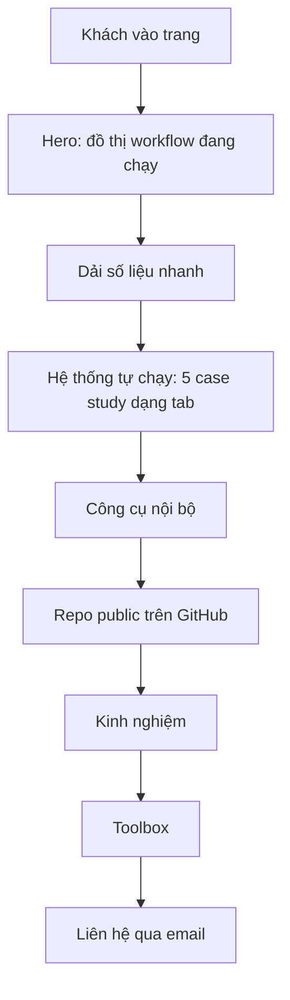

# Portfolio — Vo Duy Bao Khanh

Static one-page site (HTML + CSS + vanilla JS, no build). Content comes from the CV and the Nava Store automation notes.

## Cấu trúc trang



Nội dung gốc (tiếng Anh) nằm trong `index.html`; `assets/vi.js` giữ bản dịch tiếng Việt, khóa là đúng `innerHTML` tiếng Anh của phần tử. `assets/main.js` lo hành vi: đồ thị canvas, log mẫu, tab, hiệu ứng cuộn, nút đổi ngôn ngữ EN/VI (nhớ lựa chọn trong localStorage, mặc định theo ngôn ngữ trình duyệt).

## Chạy local

```bash
python -m http.server 8765   # rồi mở http://localhost:8765
```

## Sửa nội dung

- Case study / công cụ / kinh nghiệm: sửa trong `index.html`, rồi sửa khóa tương ứng trong `assets/vi.js` (đổi chữ tiếng Anh mà không đổi khóa thì bản VI mất dịch, console cảnh báo `i18n: no Vietnamese entry`).
- Màu, font, khoảng cách: biến CSS ở đầu `assets/styles.css`.
- Node và cạnh của đồ thị hero: hằng `NODES`, `EDGES` đầu `assets/main.js`.
- Run-log ở hero là dữ liệu minh hoạ (có ghi chú "illustrative" trên trang), không phải log thật.
- Danh sách repo public chỉ dùng repo có thật; mô tả chỉ ghi khi CV hoặc GitHub có nói.

## Deploy

Bất kỳ host tĩnh nào (GitHub Pages, Cloudflare Pages). Thư mục gốc là `/`.
Ảnh chia sẻ là `assets/og.png` (1200×630, chụp từ hero). Thẻ `og:image` đang là đường dẫn tương đối; sau khi có domain thật phải đổi thành URL tuyệt đối, nếu không Facebook/Zalo/LinkedIn không hiện ảnh.
